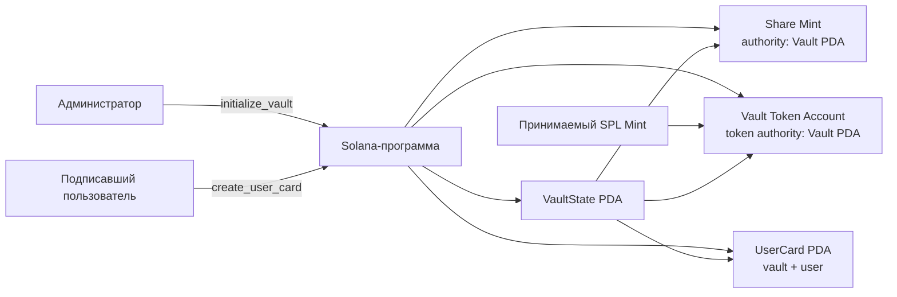

# Liquidity Vault — Week 08

Учебный проект Solana: безопасный каркас vault и персональных карточек пользователей. Проект этой недели самостоятелен и находится в `week-08/`.

## Цель

Liquidity Vault в следующих неделях будет хранить токены пользователей и выпускать share-токены, учитывающие их доли. На неделе 08 создаются только базовые аккаунты и инструкции — токены пользователей пока не принимаются.

## Реализовано

- `initialize_vault`: создаёт PDA состояния vault, SPL mint для будущих shares и SPL token account для принимаемого mint.
- `create_user_card`: создаёт одну PDA-карточку для подписавшего транзакцию пользователя.
- Числовые поля учета и балансы начинаются с нуля.
- Anchor constraints проверяют seeds, bump, mint, token authority и подпись пользователя.

В этой версии нет депозитов, выпуска shares, снятия средств, комиссий или взаимодействия с Raydium. Программа не имеет административной инструкции для выпуска shares или перемещения токенов.

## Технологии и версии

| Инструмент | Версия |
|---|---|
| Ubuntu | 24.04 LTS |
| Архитектура | x86_64 |
| Rust / Cargo | 1.100.0 |
| Solana CLI | 2.3.0 |
| Anchor CLI / `anchor-lang` / `anchor-spl` | 0.31.1 |
| AVM | 1.2.2 |
| SBF platform-tools / bundled Rust | 1.51.1 / 1.84.1-dev |
| Node.js / npm | 24.22.2 / 11.19.1 |
| Yarn | 1.22.22 |
| TypeScript | 5.3.3 |
| SPL Token JS SDK | 0.4.9 |

Версии Anchor выбраны по проекту преподавателя. Его README указывает Solana CLI 1.18+, но не закрепляет конкретную версию; сборка Anchor 0.31.1 установила Solana CLI 2.3.0 и SBF platform-tools 1.51.1. TypeScript и SPL Token SDK закреплены в `package.json`, Rust-зависимости — в `Cargo.lock`.

SBF builder использует собственный Rust 1.84.1-dev, поэтому Cargo.lock сохраняет совместимые версии транзитивных crates. Прямые pins `blake3` и `constant_time_eq` повторяют обоснование из manifest преподавателя и не добавляют функциональность программы.

## Архитектура аккаунтов и PDA

| Аккаунт | Seeds | Владелец аккаунта Solana | Полномочия / данные |
|---|---|---|---|
| `VaultState` | `["vault", token_mint]` | программа | admin, mint-ы, адрес token account, нулевые totals и bump |
| Vault token account | `["vault_tokens", token_mint]` | SPL Token Program | mint равен `token_mint`; внутренний token authority — PDA `VaultState` |
| Share mint | `["share_mint", token_mint]` | SPL Token Program | decimals = 6; mint authority — PDA `VaultState`; supply = 0 |
| `UserCard` | `["user_card", vault_state, user]` | программа | vault, владелец, deposited = 0, shares = 0 и bump |

`VaultState::LEN` включает 8 байт Anchor discriminator: `8 + 32 + 32 + 32 + 32 + 8 + 8 + 1 = 153` байта. `UserCard::LEN`: `8 + 32 + 32 + 8 + 8 + 1 = 89` байт.

SPL token account принадлежит Token Program на уровне аккаунта Solana, но его внутреннее поле `owner` (token authority) указывает на PDA vault. У PDA нет приватного ключа: только программа может подписать CPI от имени PDA с корректными seeds. Поэтому администратор не может подписать перевод или mint shares своей обычной подписью. В этой неделе соответствующие инструкции перевода и mint вообще не реализованы.

## Инструкции

### `initialize_vault`

Администратор подписывает транзакцию и оплачивает rent. Создаются все три аккаунта. `token_mint` должен быть существующим SPL Mint. Seeds однозначно задают адреса относительно этого mint, поэтому повторная инициализация того же vault и подмена PDA отклоняются. Mint shares фиксирован на 6 decimals, его supply при создании равен нулю.

### `create_user_card`

Пользователь подписывает транзакцию и оплачивает собственную карточку. `vault_state` проверяется как PDA, а карточка выводится из seeds vault и подписавшегося пользователя. Для пары (vault, user) существует только один адрес, поэтому повторный `init` отклоняется. Карточка не может быть создана для чужого пользователя без его подписи.

## Схема



## Подготовка окружения

На Ubuntu/Codespaces установите Rust stable, Solana CLI 2.3.0 и Anchor CLI 0.31.1 через AVM:

```bash
curl --proto '=https' --tlsv1.2 -sSf https://sh.rustup.rs | sh -s -- -y --profile minimal
sh -c "$(curl -sSfL https://release.anza.xyz/v2.3.0/install)"
cargo install --git https://github.com/coral-xyz/anchor avm --locked
avm install 0.31.1
avm use 0.31.1
```

Для SBF-сборки Anchor загрузит совместимые platform-tools. Затем из этой папки установите JS-зависимости:

```bash
cd week-08
corepack yarn@1.22.22 install --frozen-lockfile
```

Первый `yarn install` создаёт и фиксирует `yarn.lock`. Не добавляйте `target/`, `node_modules/`, `.anchor/` или wallet keypair в Git.

## Сборка и тестирование

```bash
cd week-08
anchor build
anchor test
```

`anchor test` поднимает локальный validator, деплоит программу в localnet и запускает TypeScript-интеграционные тесты. В тестах создаются настоящий тестовый SPL Mint и аккаунты; они проверяют состояние vault и mint-ов, права, PDA-карточки, повторное создание и неавторизованный выпуск shares.

Последняя проверка в Codespaces: `anchor build` завершился успешно (с предупреждениями от макросов Anchor 0.31.1), `yarn tsc --noEmit` завершился успешно, `anchor test` — **5 passing, 0 failing**. Это пять тестовых функций `it`; внутри них есть дополнительные assertions.

## Devnet

Используйте только отдельный тестовый keypair. В текущем Codespace его публичный адрес:

`8e4137ux92gPoVgbAhx3kSYiaG927NWeuj5BDfXinfSF`

Приватный keypair находится вне репозитория в `~/.config/solana/id.json`. Не копируйте его в проект и не публикуйте. Убедитесь, что на этом пути нет чужого ключа, прежде чем создавать собственный кошелёк на другой машине.

После успешных localnet-тестов:

```bash
cd week-08
solana config set --url devnet
solana balance
anchor deploy --provider.cluster devnet
ANCHOR_PROVIDER_URL=https://api.devnet.solana.com \
ANCHOR_WALLET="$HOME/.config/solana/id.json" \
  corepack yarn@1.22.22 init:devnet
```

Для нехватки тестовых SOL используйте официальный faucet или один ограниченный запрос, например `solana airdrop 2`. Не повторяйте запросы при rate limit. `scripts/init-devnet.ts` создаёт отдельный тестовый mint, инициализирует vault и карточку, затем перечитывает данные и печатает подтверждённые подписи и Explorer-ссылки. Program ID, появление которого в конфигурации не подтверждает деплой, проверяется отдельно командой:

```bash
solana program show 4sPijvz6HPcDKjFx8BWZEomVy5G3N1oJpeZXMCtPL2qs --url devnet
```

### Результаты devnet

Деплой **не подтверждён**: `solana program show` вернул, что аккаунт программы не найден. Devnet-баланс тестового кошелька — `0 SOL`; единственный запрос `solana airdrop 2` был отклонён из-за rate limit. Rent-exempt minimum для размера программы 275 288 байт составляет `1.39911328 SOL`; вместе с созданием тестовых аккаунтов и комиссиями потребуется ориентировочно 1.5–2 SOL.

| Сущность | Значение |
|---|---|
| Тестовый кошелёк (публичный адрес) | `8e4137ux92gPoVgbAhx3kSYiaG927NWeuj5BDfXinfSF` |
| Program ID | `4sPijvz6HPcDKjFx8BWZEomVy5G3N1oJpeZXMCtPL2qs` (сгенерирован локально; в devnet не найден) |
| Vault / Share Mint / Token Account / User Card | Не созданы |
| Подтверждённые транзакции / Explorer-ссылки | Нет |

Чтобы продолжить, запросите тестовые SOL через [официальный faucet](https://faucet.solana.com/), затем выполните команды деплоя выше. Скрипт создаст адреса и выведет ссылки только после успешных подтверждений.

## Ограничения

- Нет deposit, share minting для пользователей, withdraw, комиссий, pause/unpause и Raydium.
- Тесты localnet не заменяют подтверждение отдельного devnet deployment.
- Пользовательская карточка хранит только поля каркаса и пока не обновляется.

## Источники

- [Репозиторий курса: README и программа](https://github.com/0xnurda/vault-dev/tree/students-vault-card)
- [Solana Documentation](https://solana.com/docs)
- [Anchor Documentation](https://www.anchor-lang.com/docs)
- [Официальный Solana Faucet](https://faucet.solana.com/)
